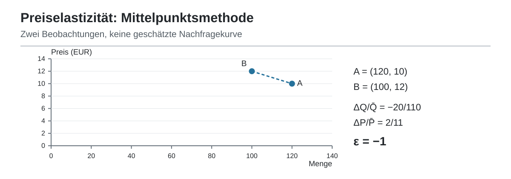

# M3-L1 – Märkte und Preiselastizität {#L1}

**Kursbereich:** M3 – Volkswirtschaft

**Niveau:** Bachelor · Kern/Grundlagen

**Vorwissen:** [M2-L2](M2-L2.md)

**Lernziel:** Preiselastizität mit der Mittelpunktsmethode bestimmen und von kausaler Preiswirkung unterscheiden.

## Einstieg und Grundbegriffe {#S1}

Angebot und Nachfrage beschreiben Mengen, die bei verschiedenen Preisen unter sonst gleichen Bedingungen angeboten und nachgefragt werden. Das Marktgleichgewicht gleicht beide Mengen im Modell aus. Preiselastizität der Nachfrage misst die relative Mengenänderung bezogen auf die relative Preisänderung. Die Mittelpunktsmethode verwendet die Mittelwerte beider Ausgangs- und Endwerte als Nenner und vermeidet eine Abhängigkeit von der Änderungsrichtung.

## Begriffszusammenhang {#S2}

*Abbildung: Zwei beobachtete Punkte: Menge 120 bei Preis 10 und Menge 100 bei Preis 12; Elastizität −1.*

## Beispiel und Anwendung {#S3}

Der Preis steigt von 10 auf 12 Euro, die Menge fällt von 120 auf 100. Die relative Mengenänderung ist −20/110, die relative Preisänderung 2/11. Der Quotient ist −1, also betragsmäßig eins.

## Selbstkontrolle {#S4}

### Aufgabe

Erkläre, weshalb ein beobachteter Mengenrückgang nicht zwingend die kausale Wirkung des Preises zeigt.

::: {.lc-solutions data-lc-section="S4"}
Andere Einflussgrößen wie Saison, Konkurrenz oder Nachfrageverschiebungen können gleichzeitig wirken. Eine Identifikationsstrategie ist nötig.
:::

## Weiterführung {#S5}

[M3-L2](M3-L2.md)

## Quellen und Vertiefung {#S6}

- [OpenStax – Principles of Economics 3e, 5.1 Price Elasticity of Demand and Price Elasticity of Supply](https://openstax.org/books/principles-economics-3e/pages/5-1-price-elasticity-of-demand-and-price-elasticity-of-supply) · Mittelpunktsmethode und Elastizitätsberechnung; Fachabschnitt eingesehen · Zuletzt abgerufen: 2026-11-25
