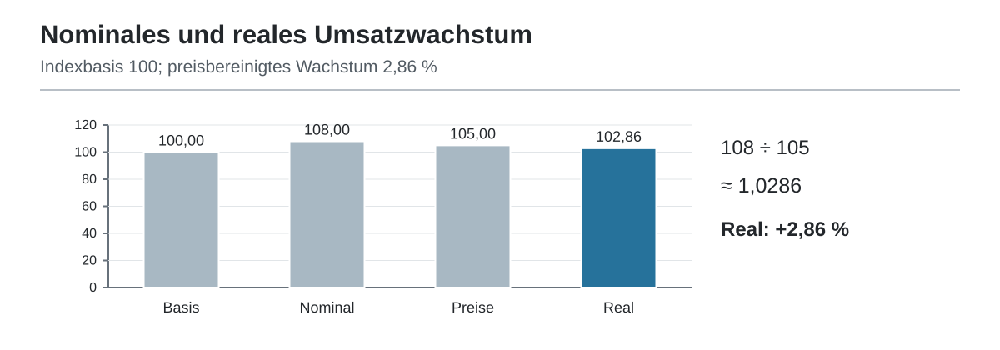

# M3-L2 – Makroökonomie und digitale Märkte {#L2}

**Kursbereich:** M3 – Volkswirtschaft

**Niveau:** Bachelor · Kern/Grundlagen

**Vorwissen:** [M3-L1](M3-L1.md)

**Lernziel:** Reales und nominales Wachstum unterscheiden und die Bedeutung von Netzwerkeffekten erklären.

## Einstieg und Grundbegriffe {#S1}

Makroökonomie untersucht aggregierte Größen wie Produktion, Beschäftigung, Inflation und Zinsen. Nominale Größen verwenden laufende Preise, reale Größen bereinigen Preisänderungen. Digitale Märkte können hohe Fixkosten und geringe zusätzliche Kopierkosten aufweisen; Netzwerkeffekte beeinflussen den Nutzen eines Dienstes mit der Anzahl seiner Nutzer. Weder Skaleneffekte noch Netzwerkeffekte garantieren Marktmacht oder Erfolg.

## Begriffszusammenhang {#S2}

*Abbildung: Indexwerte: Ausgang 100, nominal 108, Preisniveau 105, real 102,86.*

## Beispiel und Anwendung {#S3}

Der nominale Umsatz wächst um 8 Prozent, das passende Preisniveau um 5 Prozent. Der preisbereinigte Wachstumsfaktor beträgt 1,08/1,05, also ungefähr 2,86 Prozent Wachstum.

### Vertiefung und Modellgrenzen

Bei negativen externen Effekten stimmen private und gesellschaftliche Grenzkosten nicht überein. Ein Marktgleichgewicht kann daher ineffizient sein. Netzwerkeffekte, Marktmacht und Informationsasymmetrien sind weitere, voneinander zu unterscheidende Mechanismen; die Existenz eines Netzwerkeffekts beweist noch keinen Missbrauch von Marktmacht.

## Selbstkontrolle {#S4}

### Aufgabe

Weshalb ist die Anzahl der Nutzer allein kein ausreichendes Maß für den Nutzen eines Marktplatzes?

### Modul-Fallstudie

Ein hypothetischer Markt habe Nachfrage p=100−q, private Grenzkosten 20 und konstante externe Grenzkosten 10. Bestimme die private und gesellschaftlich effiziente Menge bei vollständigem Wettbewerb. Welche idealisierte Abgabe würde die Differenz internalisieren?

::: {.lc-solutions data-lc-section="S4"}
Aktivität, passende Angebote, Vertrauen, Preise und Transaktionsqualität bestimmen mit, ob Nutzer tatsächlich profitieren.

**Lösung der Fallstudie:** Privat 100−q=20, also q=80. Gesellschaftlich 100−q=30, also q=70. Eine Stückabgabe von 10 stellt die gesellschaftlichen Grenzkosten im Modell her. Das Ergebnis setzt korrekte Kenntnis der Schäden, Wettbewerb und unveränderte Nachfrage voraus; die Verteilungswirkung ist damit noch nicht geklärt.

:::

## Weiterführung {#S5}

[M3-L3](M3-L3.md)

## Quellen und Vertiefung {#S6}

- [Universität Münster – Aufbau des Wirtschaftsinformatikstudiums (B.Sc.)](https://www.wi.uni-muenster.de/de/studieninteressierte/unsere-studiengaenge/bachelor-science-wirtschaftsinformatik/aufbau-des) · Studienprofil; curricularer Kontext, kein Einzelnachweis der Fachdetails · Zuletzt abgerufen: 2026-11-25
- [OpenStax – Principles of Economics 3e, Ch. 12 Summary](https://openstax.org/books/principles-economics-3e/pages/12-key-concepts-and-summary) · Externe Effekte und Marktversagen; keine Bilanzierungsmethode · Zuletzt abgerufen: 2026-11-25
