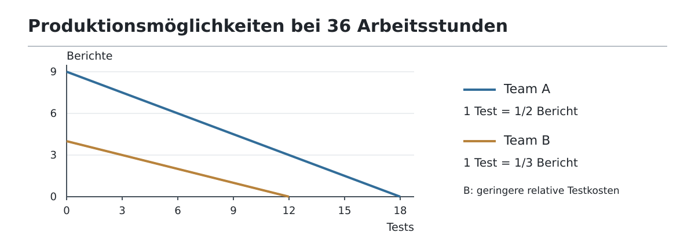

# M3-L3 – Komparative Vorteile und IT-Sourcing {#L3}

**Kursbereich:** M3 – Volkswirtschaft

**Niveau:** Bachelor · Kern/Grundlagen

**Vorwissen:** [M3-L2](M3-L2.md)

**Lernziel:** Opportunitätskosten für IT-Leistungen bestimmen und Spezialisierung einschließlich Übergabekosten beurteilen.

## Einstieg und Grundbegriffe {#S1}

Ein absoluter Vorteil besteht, wenn eine Einheit weniger Ressourcen je Leistung benötigt. Ein komparativer Vorteil dagegen beschreibt geringere Opportunitätskosten: Wie viel einer anderen Leistung muss für eine zusätzliche Einheit aufgegeben werden? Selbst ein Team, das in beiden Tätigkeiten schneller ist, kann von einer Spezialisierung profitieren, wenn die relativen Produktivitäten verschieden sind. Das vereinfachte Modell nimmt konstante Arbeitszeiten, homogene Qualität und frei teilbare Aufgaben an. Im IT-Sourcing müssen zusätzlich Koordination, Wissensverlust, Informationssicherheit, Verträge, Lieferantenabhängigkeit und Wechselkosten betrachtet werden. Spezialisierung ist kein Beweis, dass eine vollständige Auslagerung vorteilhaft ist. Für eine reale Make-or-buy-Entscheidung werden die relevanten zusätzlichen Kosten und entgangenen Alternativerträge unter Kapazitätsrestriktionen verglichen; die Total Cost of Ownership erfasst zusätzlich die Kosten über die Nutzungsdauer.

## Begriffszusammenhang {#S2}

*Abbildung: Produktionsgrenzen beider Teams: A bis 18 Tests oder 9 Berichte, B bis 12 Tests oder 4 Berichte. Eigenes Modellbeispiel.*

## Beispiel und Anwendung {#S3}

Team A benötigt 2 Stunden für einen Test und 4 Stunden für einen Bericht. Team B benötigt 3 Stunden für einen Test und 9 Stunden für einen Bericht. A ist absolut in beiden Tätigkeiten schneller. Ein Test kostet A 0,5 Berichte, B dagegen 1/3 Bericht. B hat den komparativen Vorteil bei Tests; A hat ihn bei Berichten (2 Tests gegenüber 3). Bei je 36 Stunden sind als Eckpunkte A: 18 Tests oder 9 Berichte; B: 12 Tests oder 4 Berichte möglich. Für einen Bedarf von 12 Tests und 9 Berichten wäre die Spezialisierung innerhalb der Kapazitäten möglich, ohne zusätzliche Zeit.

## Selbstkontrolle {#S4}

### Aufgabe

Wenn B für die Übergabe jedes Tests eine zusätzliche Stunde benötigt und A keine Übergabezeit hat, wie ändern sich die Opportunitätskosten eines Tests bei B? Nenne eine Modellgrenze.

::: {.lc-solutions data-lc-section="S4"}
B: 4/9 Bericht je Test, weiterhin kleiner als 1/2 bei A. B kann nun aber nur neun Tests in 36 Stunden liefern; das alte Produktionsziel ist nicht mehr durch vollständige Spezialisierung erreichbar. Qualität und Abhängigkeiten werden nicht durch Stunden allein erfasst.
:::

## Weiterführung {#S5}

[M3-L4](M3-L4.md)

## Quellen und Vertiefung {#S6}

- [OpenStax – Principles of Economics 3e, 33.1 Absolute and Comparative Advantage](https://openstax.org/books/principles-economics-3e/pages/33-1-absolute-and-comparative-advantage) · Methodischer Fachbeleg; relevante Passage im Web eingesehen. Zuletzt abgerufen: 2026-11-25.
