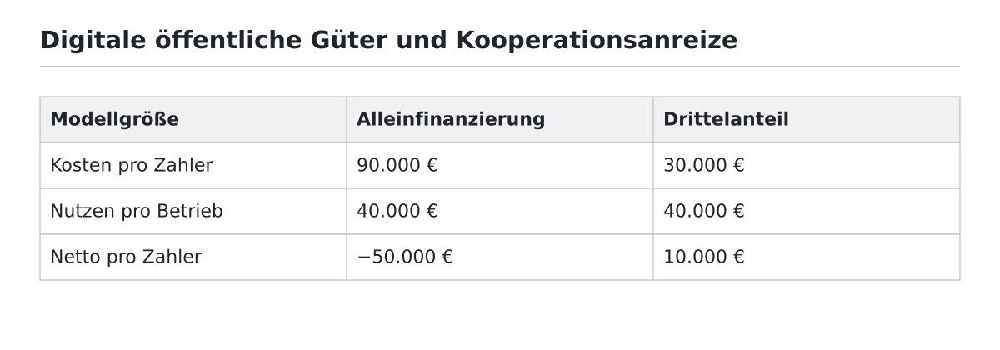

# M3-L4 – Digitale öffentliche Güter und Kooperationsanreize {#L4}

**Kursbereich:** M3 – Volkswirtschaft

**Niveau:** Bachelor · Kern/Grundlagen

**Vorwissen:** [M3-L3](M3-L3.md)

**Lernziel:** Gesamtüberschuss und individuelle Beiträge bei gemeinschaftlich finanzierten digitalen Gütern vergleichen.

## Einstieg und Grundbegriffe {#S1}

Öffentliche Güter werden ökonomisch durch Nichtausschließbarkeit und Nichtrivalität charakterisiert. Eine öffentlich zugängliche digitale Spezifikation kann beiden Kriterien näherkommen: Ihre Nutzung durch einen Betrieb verringert die Verfügbarkeit für andere kaum, und die öffentliche Verteilung macht Ausschluss schwierig. Die Entwicklung, Pflege und Prüfung verursachen trotzdem Kosten. Ein zugangsbeschränktes Softwareangebot ist demgegenüber ausschließbar; Rechenkapazität kann rivalisierend sein. Die Eigenschaften betreffen die tatsächliche Nutzung, nicht allein das digitale Format oder die Lizenz.

Trittbrettfahren entsteht, wenn Akteure vom bereitgestellten Gut profitieren können, ohne selbst zur Finanzierung beizutragen. Private Zahlungsbereitschaft kann dann unter dem gesellschaftlichen Nutzen liegen. Positive externe Effekte allein genügen jedoch nicht für die Klassifikation als öffentliches Gut. Gemeinsame Finanzierung, vertraglich zugesicherte Beiträge und institutionelle Trägerschaft können den Koordinationskonflikt vermindern. Für die Wirtschaftsinformatik ist die Frage relevant, wenn Unternehmen interoperable Standards, gemeinsam nutzbare Datenstrukturen oder Sicherheitsbibliotheken pflegen.

## Begriffszusammenhang {#S2}

*Abbildung: Finanzierungsanreize einer gemeinsamen Schnittstellenspezifikation. Eigenes Modellbeispiel.*

## Beispiel und Anwendung {#S3}

Drei Betriebe könnten eine öffentliche Schnittstellenspezifikation für 90.000 € erstellen. Der jährliche Nutzen im Modell beträgt je 40.000 €; die Kosten fallen einmalig im betrachteten Jahr an. Gesamtüberschuss bei Bereitstellung: 120.000 − 90.000 = 30.000 €. Kein Betrieb finanziert freiwillig allein, wenn er nur seinen eigenen Nutzen bewertet. Bei einem verbindlichen Drittelanteil zahlt jeder 30.000 € und gewinnt netto 10.000 €. Das Modell unterstellt sichere Nutzenwerte, keine weiteren Kosten und keine alternativen Verwendungen der Mittel.

## Selbstkontrolle {#S4}

### Aufgabe

Ein vierter Betrieb erzielt 15.000 € Nutzen, ohne zu zahlen. Wie verändert sich der Gesamtüberschuss? Würde ein gleicher Beitrag aller vier für den neuen Betrieb individuell attraktiv sein?

::: {.lc-solutions data-lc-section="S4"}
Gesamtüberschuss 45.000 €. Ein Viertel der Kosten beträgt 22.500 €, also wäre sein individueller Nettoeffekt −7.500 €. Eine andere Verteilung kann Kooperation ermöglichen.
:::

## Weiterführung {#S5}

[M4-L1](M4-L1.md)

## Quellen und Vertiefung {#S6}

- [OpenStax – Principles of Economics 3e, 13.3 Public Goods](https://openstax.org/books/principles-economics-3e/pages/13-3-public-goods) · Methodischer Fachbeleg; relevante Passage im Web eingesehen. Zuletzt abgerufen: 2026-11-25.
