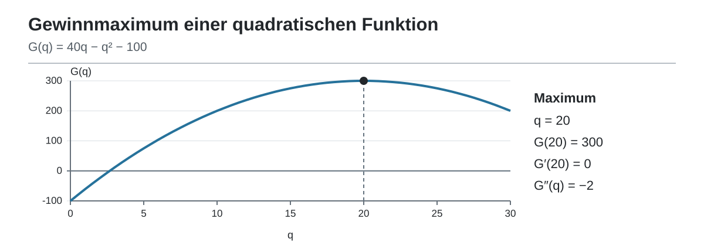

# M4-L1 – Funktionen und Optimierung {#L1}

**Kursbereich:** M4 – Wirtschaftsmathematik

**Niveau:** Bachelor · Kern/Grundlagen

**Vorwissen:** [M3-L2](M3-L2.md)

**Lernziel:** Eine Gewinnfunktion unter einer Mengenbeschränkung maximieren.

## Einstieg und Grundbegriffe {#S1}

Eine Funktion ordnet einer Eingabe einen Wert zu. In wirtschaftlichen Modellen beschreibt etwa R(q) den Erlös einer Menge q, C(q) die Kosten und G(q)=R(q)−C(q) den Gewinn. Bei differenzierbaren Funktionen ist eine innere Extremstelle nur dann möglich, wenn die erste Ableitung null ist. Randpunkte und Nebenbedingungen bleiben zu prüfen; an einer stationären Stelle ist eine negative zweite Ableitung bei zweimal stetiger Differenzierbarkeit hinreichend für ein striktes lokales Maximum.

## Begriffszusammenhang {#S2}

*Abbildung: Gewinnfunktion mit Scheitelpunkt bei q gleich 20 und Gewinn 300.*

## Beispiel und Anwendung {#S3}

G(q)=40q−q²−100 für q zwischen 0 und 30. G′(q)=40−2q, daher q=20. G″(q)=−2. Der Gewinn beträgt 300; die Randwerte sind −100 und 200, also liegt das Maximum bei 20.

## Selbstkontrolle {#S4}

### Aufgabe

Welche Menge maximiert denselben Gewinn, wenn q höchstens 15 betragen darf?

::: {.lc-solutions data-lc-section="S4"}
q=15, weil G′ auf dem Intervall 0 bis 15 positiv ist. Der Gewinn beträgt 275.
:::

## Weiterführung {#S5}

[M4-L2](M4-L2.md)

## Quellen und Vertiefung {#S6}

- [Universität Münster – Aufbau des Wirtschaftsinformatikstudiums (B.Sc.)](https://www.wi.uni-muenster.de/de/studieninteressierte/unsere-studiengaenge/bachelor-science-wirtschaftsinformatik/aufbau-des) · Studienprofil; curricularer Kontext, kein Einzelnachweis der Fachdetails · Zuletzt abgerufen: 2026-11-25
- [OpenStax – Calculus Volume 1, 4.7 Applied Optimization Problems](https://openstax.org/books/calculus-volume-1/pages/4-7-applied-optimization-problems) · Optimierung unter Nebenbedingungen und Gewinnfunktion · Zuletzt abgerufen: 2026-11-25
