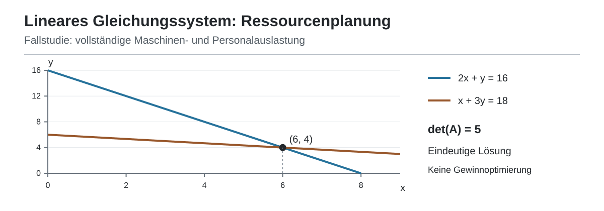

# M4-L2 – Lineare Algebra und Zinsrechnung {#L2}

**Kursbereich:** M4 – Wirtschaftsmathematik

**Niveau:** Bachelor · Kern/Grundlagen

**Vorwissen:** [M4-L1](M4-L1.md)

**Lernziel:** Ein lineares Gleichungssystem zur Ressourcenplanung lösen und Barwerte berechnen.

## Einstieg und Grundbegriffe {#S1}

Vektoren bündeln Größen, Matrizen beschreiben lineare Zusammenhänge zwischen mehreren Eingaben und Ausgaben. Bei Matrixmultiplikation entspricht jedes Ergebnis einer Summe gewichteter Eingaben. In der Zinsrechnung wächst eine einmalige Zahlung bei konstantem Periodenzins r über n Perioden um den Faktor (1+r) hoch n. Diese exponentielle Entwicklung unterscheidet sich von einer einfachen linearen Fortschreibung.

## Begriffszusammenhang {#S2}

*Abbildung: Ressourcengleichungen 2x+y=16 und x+3y=18 schneiden sich bei x=6 und y=4; die Determinante beträgt 5.*

## Beispiel und Anwendung {#S3}

Zwei Produkte benötigen je zwei bzw. drei Stunden. Bei vier Einheiten des ersten und fünf des zweiten entstehen 2·4+3·5=23 Stunden. 1.000 Euro wachsen bei 5 Prozent für zwei Jahre auf 1.102,50 Euro.

### Vertiefung und Modellgrenzen

Ein lineares Gleichungssystem Ax=b kann eine eindeutige Lösung, keine oder unendlich viele Lösungen besitzen. Bei quadratischem A ist eine von null verschiedene Determinante hinreichend für Eindeutigkeit. In Produktionsmodellen ist eine algebraische Lösung zusätzlich auf Nichtnegativität, Einheiten und tatsächliche Kapazität zu prüfen.

Geometrisch schneiden sich die beiden Ressourcengeraden im Punkt (6, 4). Mit der Cramerschen Regel ergeben sich die Zählerdeterminanten 30 und 20, jeweils dividiert durch 5. Die Gerade stellt eine Gleichheit dar, keine vollständige zulässige Menge eines Optimierungsproblems.

## Selbstkontrolle {#S4}

### Aufgabe

Berechne den Barwert von 1.102,50 Euro bei denselben Zinsannahmen.

### Modul-Fallstudie

Zwei Produkte x und y nutzen die Ressourcen mit den Koeffizienten (2,1) für Maschine und (1,3) für Personal. Bei vollständiger Auslastung gelten 2x+y=16 und x+3y=18. Löse das System, berechne die Determinante und prüfe beide Ressourcen.

::: {.lc-solutions data-lc-section="S4"}
Division durch 1,05² ergibt 1.000 Euro. Zins und Periodenzahl müssen dieselbe Zeiteinheit verwenden.

**Lösung der Fallstudie:** det(A)=2·3−1·1=5. Aus y=16−2x folgt x+48−6x=18, also x=6 und y=4. Kontrolle: 12+4=16 und 6+12=18. Nichtnegative ganzzahlige Werte sind hier möglich, aber nicht generell garantiert. Vollauslastung allein beweist keine Gewinnoptimalität.

:::

## Weiterführung {#S5}

[M4-L3](M4-L3.md)

## Quellen und Vertiefung {#S6}

- [Universität Münster – Aufbau des Wirtschaftsinformatikstudiums (B.Sc.)](https://www.wi.uni-muenster.de/de/studieninteressierte/unsere-studiengaenge/bachelor-science-wirtschaftsinformatik/aufbau-des) · Studienprofil; curricularer Kontext, kein Einzelnachweis der Fachdetails · Zuletzt abgerufen: 2026-11-25
- [OpenStax – College Algebra 2e, 7.8 Solving Systems with Cramer’s Rule](https://openstax.org/books/college-algebra-2e/pages/7-8-solving-systems-with-cramers-rule) · Determinante und eindeutige Lösung linearer Gleichungssysteme · Zuletzt abgerufen: 2026-11-25
