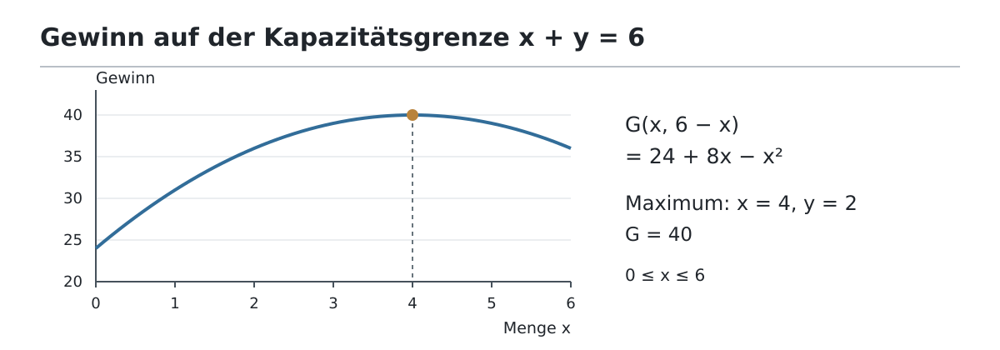

# M4-L3 – Partielle Ableitungen und mehrdimensionale Optimierung {#L3}

**Kursbereich:** M4 – Wirtschaftsmathematik

**Niveau:** Bachelor · Kern/Grundlagen

**Vorwissen:** [M4-L2](M4-L2.md)

**Lernziel:** Ein zweidimensionales Gewinnmaximum bestimmen und eine bindende Nebenbedingung berücksichtigen.

## Einstieg und Grundbegriffe {#S1}

Eine Funktion mehrerer Variablen kann beispielsweise den Gewinn abhängig von zwei Produktmengen beschreiben. Die partielle Ableitung nach x misst die lokale Änderung, wenn y festgehalten wird. Der Gradient sammelt die ersten partiellen Ableitungen. An einem differenzierbaren inneren lokalen Optimum ohne Nebenbedingungen muss der Gradient null sein. Das ist nur eine notwendige Bedingung. Zweite Ableitungen bilden die Hesse-Matrix; bei negativer Definitheit an einem stationären Punkt liegt ein striktes lokales Maximum vor. Ist die Funktion auf dem gesamten konvexen Definitionsbereich streng konkav, ist ein stationärer innerer Punkt zugleich das eindeutige globale Maximum. Bei Kapazitätsgrenzen sind Randpunkte und zulässige Richtungen separat zu untersuchen. In der Praxis sind Mengen möglicherweise ganzzahlig und Parameter nur geschätzt.

## Begriffszusammenhang {#S2}

*Abbildung: Gewinn entlang der Kapazitätsgrenze mit Maximum 40 bei x gleich 4 und y gleich 2. Eigenes Modellbeispiel.*

## Beispiel und Anwendung {#S3}

Sei G(x,y) = 12x + 10y − x² − y² − xy für nichtnegative kontinuierliche Mengen. ∂G/∂x = 12 − 2x − y, ∂G/∂y = 10 − 2y − x. Nullsetzen ergibt 2x+y=12 und x+2y=10, also x=14/3 und y=8/3. Die Hesse-Matrix hat Diagonale −2, Nebendiagonale −1; ihre Eigenwerte sind −3 und −1. Damit liegt das eindeutige globale Maximum bei G=124/3 ≈ 41,33. Gegenprobe: G(4,3)=41 und G(5,3)=41. Beide ganzzahligen Alternativen liegen knapp darunter.

## Selbstkontrolle {#S4}

### Aufgabe

Prüfe, ob das kontinuierliche Optimum bei x+y ≤ 6 zulässig ist. Maximiere G auf der Randgeraden x+y=6, x,y≥0.

::: {.lc-solutions data-lc-section="S4"}
14/3+8/3=22/3>6. Setze y=6−x: G=24+8x−x², Maximum bei x=4, y=2, G=40. Auch die beiden übrigen Ränder sind zu prüfen: Für x=0 ist das Maximum von 10y−y² bei y=5 gleich 25; für y=0 ist das Maximum von 12x−x² bei x=6 gleich 36. Beide liegen unter 40. Da die einzige innere stationäre Stelle außerhalb des Dreiecks liegt, ist (4,2) das globale Maximum auf dem zulässigen Dreieck.
:::

## Weiterführung {#S5}

[M5-L1](M5-L1.md)

## Quellen und Vertiefung {#S6}

- [OpenStax – Calculus Volume 3, 4.3 Partial Derivatives](https://openstax.org/books/calculus-volume-3/pages/4-3-partial-derivatives) · Methodischer Fachbeleg; relevante Passage im Web eingesehen. Zuletzt abgerufen: 2026-11-25.
- [OpenStax – Calculus Volume 3, 4.7 Maxima/Minima Problems](https://openstax.org/books/calculus-volume-3/pages/4-7-maxima-minima-problems) · Stationäre Stellen und hinreichender Test zweiter Ordnung; Randrechnung im Kurs eigenständig · Zuletzt abgerufen: 2026-11-25
