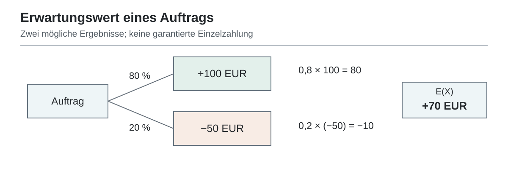

# M5-L1 – Wahrscheinlichkeit und Erwartungswert {#L1}

**Kursbereich:** M5 – Statistik und Datenanalyse

**Niveau:** Bachelor · Kern/Grundlagen

**Vorwissen:** [M4-L2](M4-L2.md)

**Lernziel:** Erwartungswerte aus möglichen Auszahlungen und Eintrittswahrscheinlichkeiten berechnen.

## Einstieg und Grundbegriffe {#S1}

Ein Zufallsexperiment hat mögliche Ausgänge; Ereignisse sind Mengen dieser Ausgänge. Bedingte Wahrscheinlichkeit berücksichtigt eine gegebene Information. Eine diskrete Zufallsvariable ordnet Ausgängen Zahlen zu; ihr Erwartungswert ist die Summe aus Wert mal Wahrscheinlichkeit. Dieser Erwartungswert muss kein tatsächlich möglicher Einzelwert sein. Bei einer unendlichen diskreten Verteilung setzt ein endlicher Erwartungswert die absolute Konvergenz der gewichteten Summe voraus. Bei unabhängigen identisch verteilten Wiederholungen mit endlichem Erwartungswert nähert sich der Stichprobenmittelwert nach dem Gesetz der großen Zahlen dem Erwartungswert an. Abhängigkeiten können aggregierte Risiken erheblich verändern.

## Begriffszusammenhang {#S2}

*Abbildung: 80 Prozent mit +100 Euro, 20 Prozent mit −50 Euro; Erwartungswert +70 Euro.*

## Beispiel und Anwendung {#S3}

Ein Auftrag bringt mit Wahrscheinlichkeit 0,8 einen Überschuss von 100 Euro, sonst einen Verlust von 50 Euro. Erwarteter Überschuss: 0,8·100+0,2·(−50)=70 Euro.

## Selbstkontrolle {#S4}

### Aufgabe

Wie ändert sich der Erwartungswert, wenn die Erfolgswahrscheinlichkeit 0,6 beträgt?

::: {.lc-solutions data-lc-section="S4"}
0,6·100+0,4·(−50)=40 Euro. Der Erwartungswert sagt nichts über eine garantierte Einzelzahlung aus.
:::

## Weiterführung {#S5}

[M5-L2](M5-L2.md)

## Quellen und Vertiefung {#S6}

- [OpenStax – Introductory Statistics 2e, 1.1 Definitions of Statistics, Probability, and Key Terms](https://openstax.org/books/introductory-statistics-2e/pages/1-1-definitions-of-statistics-probability-and-key-terms) · Statistik- und Wahrscheinlichkeitsgrundlagen; Fachabschnitt eingesehen · Zuletzt abgerufen: 2026-11-25
- [OpenStax – Introductory Statistics 2e, 4.2 Mean or Expected Value and Standard Deviation](https://openstax.org/books/introductory-statistics-2e/pages/4-2-mean-or-expected-value-and-standard-deviation) · Erwartungswert diskreter Zufallsvariablen · Zuletzt abgerufen: 2026-11-25
