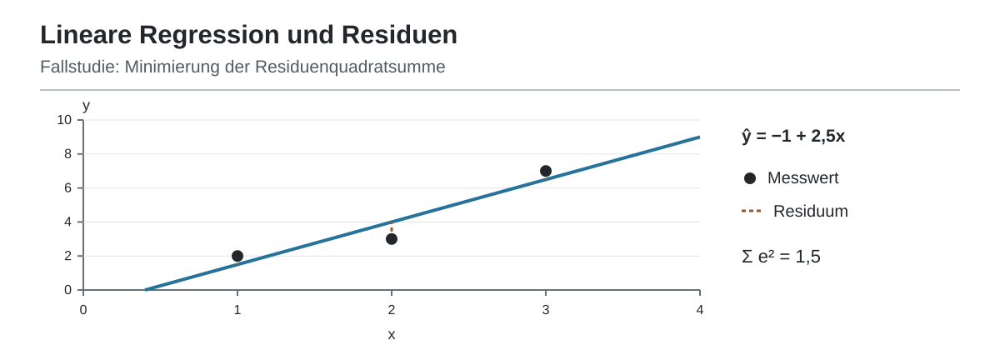

# M5-L2 – Schätzung, Inferenz und Regression {#L2}

**Kursbereich:** M5 – Statistik und Datenanalyse

**Niveau:** Bachelor · Kern/Grundlagen

**Vorwissen:** [M5-L1](M5-L1.md)

**Lernziel:** Ein Konfidenzintervall berechnen und die Steigung einer einfachen Regression bestimmen.

## Einstieg und Grundbegriffe {#S1}

Eine Stichprobe liefert Schätzwerte für unbekannte Populationsparameter. Ein frequentistisches 95-Prozent-Konfidenzverfahren erzeugt bei wiederholter Anwendung unter seinen Annahmen in etwa 95 Prozent der Fälle Intervalle, die den Parameter einschließen. Lineare Regression beschreibt einen bedingten Mittelwert als lineare Funktion erklärender Variablen; Korrelation oder eine geschätzte Steigung allein begründen keine Kausalwirkung.

## Begriffszusammenhang {#S2}

*Abbildung: Drei Messpunkte, Regressionsgerade y gleich minus 1 plus 2,5 x und Residuen.*

## Beispiel und Anwendung {#S3}

Bei unabhängiger Zufallsstichprobe, hinreichend guter Normalapproximation und bekannter Populationsstandardabweichung 10 und Stichprobengröße 100 beträgt der Standardfehler des Mittelwerts 1. Bei einem beobachteten Mittelwert von 50 lautet das approximative 95-Prozent-Intervall 48,04 bis 51,96.

### Vertiefung und Modellgrenzen

Eine einfache lineare Regression mit Achsenabschnitt schätzt ŷ=a+bx durch Minimierung der quadrierten Residuen. Die Steigung ist eindeutig bestimmbar, wenn die beobachteten x-Werte nicht alle gleich sind. Der Anstieg b beschreibt einen statistischen Zusammenhang in den beobachteten Einheiten. Extrapolation, Ausreißer, unbeobachtete Störgrößen und zeitlich abhängige Residuen können die Interpretation gefährden.

## Selbstkontrolle {#S4}

### Aufgabe

Was geschieht bei einer Stichprobe von 400, wenn alle übrigen Annahmen gleich bleiben?

### Modul-Fallstudie

Für x=1,2,3 und y=2,3,7 berechne x̄, ȳ, b=Σ(x−x̄)(y−ȳ)/Σ(x−x̄)², a=ȳ−bx̄ und die Residuen. Was sagt die Schätzung für x=4 aus?

::: {.lc-solutions data-lc-section="S4"}
Der Standardfehler halbiert sich auf 0,5, die Intervallhalbbreite auf 0,98. Systematische Stichprobenverzerrung wird dadurch nicht behoben.

**Lösung der Fallstudie:** x̄=2, ȳ=4, b=5/2=2,5, a=−1. Vorhersagen 1,5; 4; 6,5. Residuen 0,5; −1; 0,5, Quadratsumme 1,5. Für x=4 lautet die Modellvorhersage 9. Sie liegt außerhalb des beobachteten Bereichs und drei Punkte reichen nicht für eine belastbare Aussage über Kausalität oder Prognosefehler.

:::

## Weiterführung {#S5}

[M5-L3](M5-L3.md)

## Quellen und Vertiefung {#S6}

- [OpenStax – Introductory Statistics 2e, Ch. 8 Introduction](https://openstax.org/books/introductory-statistics-2e/pages/8-introduction) · Einführung in Konfidenzintervalle; Fachabschnitt eingesehen · Zuletzt abgerufen: 2026-11-25
- [OpenStax – Introductory Statistics 2e, 8.1 A Single Population Mean using the Normal Distribution](https://openstax.org/books/introductory-statistics-2e/pages/8-1-a-single-population-mean-using-the-normal-distribution) · Konfidenzintervall bei bekannter Populationsstandardabweichung · Zuletzt abgerufen: 2026-11-25
- [OpenStax – Introductory Statistics 2e, 12.3 The Regression Equation](https://openstax.org/books/introductory-statistics-2e/pages/12-3-the-regression-equation) · Kleinste Quadrate, Steigung, Achsenabschnitt und Residuen · Zuletzt abgerufen: 2026-11-25
