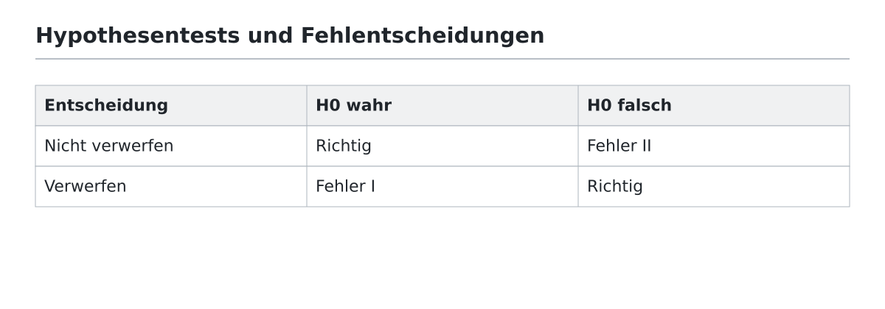

# M5-L3 – Hypothesentests und Fehlentscheidungen {#L3}

**Kursbereich:** M5 – Statistik und Datenanalyse

**Niveau:** Bachelor · Kern/Grundlagen

**Vorwissen:** [M5-L2](M5-L2.md)

**Lernziel:** Eine Testentscheidung anhand des Signifikanzniveaus treffen und beide Fehlerarten erklären.

## Einstieg und Grundbegriffe {#S1}

Ein Hypothesentest prüft eine vorab definierte Nullhypothese H0 gegen eine Alternative. Der p-Wert ist unter H0 (und den Modellannahmen) die Wahrscheinlichkeit einer mindestens so extremen Teststatistik wie beobachtet, in Richtung der Alternative. Er ist nicht die Wahrscheinlichkeit, dass H0 wahr ist. Ein Fehler erster Art ist das Verwerfen einer wahren H0; ein Fehler zweiter Art das Nichtverwerfen einer falschen H0. Das Signifikanzniveau α beschränkt unter den Testannahmen die Wahrscheinlichkeit eines Fehlers erster Art; die Teststärke 1−β hängt unter anderem von Stichprobengröße, Streuung und Effekt ab. Eine kleine statistisch signifikante Differenz kann wirtschaftlich unwichtig sein. Mehrere nachträglich ausgewählte Tests erhöhen das Risiko zufälliger Befunde. Berichte Effektgröße, Unsicherheit und Auswahlregeln; leite aus Nichtsignifikanz nicht automatisch Gleichwertigkeit ab.

## Begriffszusammenhang {#S2}

*Abbildung: Vier mögliche Entscheidungen in einem Hypothesentest. Eigenes Modellbeispiel.*

## Beispiel und Anwendung {#S3}

Ein System liefert unter H0 im Mittel 100 ms. Bei einer unabhängigen Stichprobe von n=100 wird ein Mittelwert von 104 ms beobachtet; die Populationsstandardabweichung sei bekannt und betrage 20 ms. Unter Normalität (oder geeigneter Approximation) beträgt der Standardfehler 2 ms. Der z-Wert ist (104−100)/2=2; der zweiseitige p-Wert ≈0,0455. Bei α=0,05 wird H0 verworfen. Das 95%-Konfidenzintervall ist 104±1,96×2 = [100,08;107,92] ms. Ob ein Anstieg von 4 ms relevant ist, muss anhand des Serviceziels entschieden werden.

## Selbstkontrolle {#S4}

### Aufgabe

Würde H0 bei α=0,01 verworfen? Erkläre Fehler erster und zweiter Art im Beispiel und warum 100 aufeinanderfolgende Messungen nicht unbedingt unabhängig sind.

::: {.lc-solutions data-lc-section="S4"}
Nein, p≈0,0455>0,01. Typ I: einen geänderten Mittelwert melden, obwohl er 100 ms beträgt; Typ II: einen tatsächlich veränderten Mittelwert nicht erkennen. Gemeinsame Lastspitzen und Caches können zeitliche Abhängigkeiten erzeugen; dann ist die Standardfehlerformel für unabhängige Beobachtungen nicht ohne Prüfung geeignet.
:::

## Weiterführung {#S5}

[M6-L1](M6-L1.md)

## Quellen und Vertiefung {#S6}

- [OpenStax – Introductory Statistics 2e, 9.2 Outcomes and the Type I and Type II Errors](https://openstax.org/books/introductory-statistics-2e/pages/9-2-outcomes-and-the-type-i-and-type-ii-errors) · Methodischer Fachbeleg; relevante Passage im Web eingesehen. Zuletzt abgerufen: 2026-11-25.
