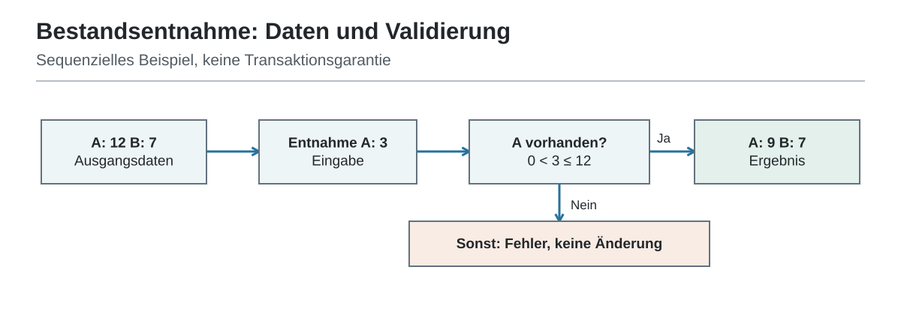

# M6-L1 – Programmierung und Datenstrukturen {#L1}

**Kursbereich:** M6 – Programmierung und Algorithmen

**Niveau:** Bachelor · Kern/Grundlagen

**Vorwissen:** [M5-L2](M5-L2.md)

**Lernziel:** Eine Bestandsentnahme mit Eingabevalidierung und geeigneten Randfalltests modellieren.

## Einstieg und Grundbegriffe {#S1}

Ein Algorithmus beschreibt endliche, eindeutige Verarbeitungsschritte. Programme realisieren Algorithmen in einer Sprache und behandeln Eingaben, Fehler und Ausgaben. Listen eignen sich für geordnete Folgen, Wörterbücher für Zuordnungen von Schlüsseln zu Werten. Die Wahl einer Datenstruktur hängt von Zugriffen, Speicherbedarf und erwarteter Datenmenge ab. Tests prüfen definierte Eigenschaften für Normal- und Randfälle.

## Begriffszusammenhang {#S2}

*Abbildung: Bestandswörterbuch A=12, B=7. Entnahme A:3 wird validiert und ergibt A=9, B=7. Ungültige Eingaben ändern keinen Wert.*

## Beispiel und Anwendung {#S3}

Ein Bestandswörterbuch enthält A: 12 und B: 7. Für eine Entnahme von 3 aus A wird zuerst geprüft, ob der Artikel existiert und der Bestand ausreicht; danach wird der Wert auf 9 gesetzt. Eine Entnahme muss eine positive ganze Stückzahl sein; null, negative und gebrochene Stückzahlen sind in diesem Modell unzulässig.

In einer sequenziellen Implementierung darf erst nach erfolgreicher Validierung geschrieben werden. Bei gleichzeitigem Zugriff mehrerer Prozesse reicht diese Prüfung allein nicht aus; die atomare Bestandsänderung wird in M7-L2 und im Abschlusslabor behandelt.

## Selbstkontrolle {#S4}

### Aufgabe

Welche drei Randfälle prüfst du zusätzlich?

::: {.lc-solutions data-lc-section="S4"}
Unbekannter Artikel, Entnahme größer als Bestand und Entnahme genau in Bestandshöhe. Die ersten beiden dürfen den Bestand nicht ändern; der dritte ergibt null.
:::

## Weiterführung {#S5}

[M6-L2](M6-L2.md)

## Quellen und Vertiefung {#S6}

- [Universität Münster – Aufbau des Wirtschaftsinformatikstudiums (B.Sc.)](https://www.wi.uni-muenster.de/de/studieninteressierte/unsere-studiengaenge/bachelor-science-wirtschaftsinformatik/aufbau-des) · Studienprofil; curricularer Kontext, kein Einzelnachweis der Fachdetails · Zuletzt abgerufen: 2026-11-25
- [Python Documentation – Data Structures](https://docs.python.org/3/tutorial/datastructures.html) · Listen, Wörterbücher, Mengen; keine formale Laufzeitgarantie · Zuletzt abgerufen: 2026-11-25
