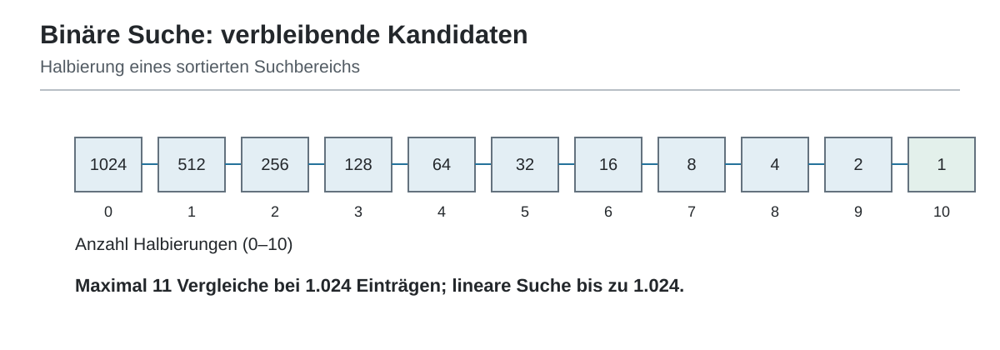

# M6-L2 – Komplexität und algorithmische Auswahl {#L2}

**Kursbereich:** M6 – Programmierung und Algorithmen

**Niveau:** Bachelor · Kern/Grundlagen

**Vorwissen:** [M6-L1](M6-L1.md)

**Lernziel:** Lineare und binäre Suche vergleichen und eine Bestandsaggregation implementieren.

## Einstieg und Grundbegriffe {#S1}

Die asymptotische Laufzeit beschreibt, wie Ressourcen mit der Eingabegröße wachsen. Lineare Suche benötigt im schlechtesten Fall n Vergleiche, binäre Suche in einer sortierten Folge mit wahlfreiem Zugriff logarithmisch viele Vergleichsschritte. Sortierung verursacht jedoch zusätzliche Arbeit. Datenstrukturen und Algorithmen sind deshalb im Zusammenhang mit wiederholten Zugriffen, Änderungen und realen Lastprofilen zu wählen.

## Begriffszusammenhang {#S2}

*Abbildung: 1.024 sortierte Einträge; nach zehn Halbierungen bleibt höchstens ein Kandidat; höchstens elf Vergleiche.*

## Beispiel und Anwendung {#S3}

Bei 1.024 sortierten Artikeln reduziert binäre Suche den Suchbereich durch Halbierung. Nach zehn Halbierungen bleibt höchstens ein Kandidat, der gegebenenfalls noch geprüft werden muss. Mit der abschließenden Kandidatenprüfung sind höchstens elf Schlüsselvergleiche nötig. Lineare Suche kann bis zu 1.024 Vergleiche erfordern.

### Vertiefung und Modellgrenzen

Die Wahl der Datenstruktur hängt vom Zugriffsmuster ab. Eine Hash-Tabelle bietet unter geeigneten Bedingungen erwartete konstante Suchzeit, eine sortierte Array-Liste logarithmische Suche, aber im ungünstigsten Fall lineare Einfügekosten. Die Angabe von elf Vergleichen im Beispiel zählt einen Dreiwege-Schlüsselvergleich pro Iteration; konkrete Implementierungen können mehrere Vergleichsoperatoren je Iteration auswerten. Laufzeitabschätzungen sind von gemessener Geschwindigkeit und Speicherbedarf zu unterscheiden.

## Selbstkontrolle {#S4}

### Aufgabe

Warum ist die binäre Suche bei einer unsortierten, häufig veränderten Liste nicht automatisch günstiger?

### Modul-Fallstudie

Implementiere eine Bestandsaggregation für die Bewegungen (A,3), (B,5), (A,−1), (B,−2), (C,0) mittels Wörterbuch. Negative Bestände sind unzulässig; prüfe den neuen Wert vor der Übernahme. Gib Ergebnis und erwarteten Aufwand für n Bewegungen an.

::: {.lc-solutions data-lc-section="S4"}
Die Sortierung oder Aufrechterhaltung der Ordnung kostet Zeit. Bei wenigen Suchen kann lineare Suche insgesamt günstiger sein.

**Lösung der Fallstudie:** Starte mit einem leeren Wörterbuch. Je Bewegung: v=stock.get(sku,0)+delta; falls v<0, Bewegung zurückweisen, sonst stock[sku]=v. Ergebnis A=2, B=3, C=0. Erwartet O(n) Zeit und O(k) Speicher für k verschiedene Schlüssel bei üblichen Hash-Annahmen. Tests: erste Entnahme, Bestand null, doppelte Ereignis-ID; Duplikatbehandlung benötigt einen zusätzlichen Identifikator.

:::

## Weiterführung {#S5}

[M6-L3](M6-L3.md)

## Quellen und Vertiefung {#S6}

- [Universität Münster – Aufbau des Wirtschaftsinformatikstudiums (B.Sc.)](https://www.wi.uni-muenster.de/de/studieninteressierte/unsere-studiengaenge/bachelor-science-wirtschaftsinformatik/aufbau-des) · Studienprofil; curricularer Kontext, kein Einzelnachweis der Fachdetails · Zuletzt abgerufen: 2026-11-25
- [Python Documentation – Data Structures](https://docs.python.org/3/tutorial/datastructures.html) · Listen, Wörterbücher, Mengen; keine formale Laufzeitgarantie · Zuletzt abgerufen: 2026-11-25
- [Python Documentation – bisect: Array bisection algorithm](https://docs.python.org/3/library/bisect.html) · Sortierte Listen und Einfügekosten; Vergleichsschrittzahl eigenständig hergeleitet · Zuletzt abgerufen: 2026-11-25
