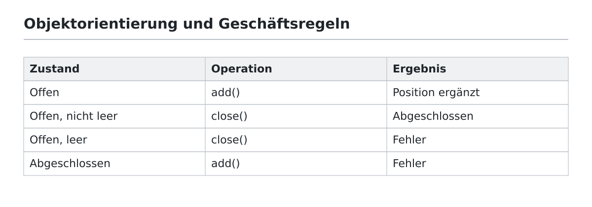

# M6-L3 – Objektorientierung und Geschäftsregeln {#L3}

**Kursbereich:** M6 – Programmierung und Algorithmen

**Niveau:** Bachelor · Kern/Grundlagen

**Vorwissen:** [M6-L2](M6-L2.md)

**Lernziel:** Bestellungen als Objekte mit getrenntem Zustand und überprüfbaren Geschäftsregeln modellieren.

## Einstieg und Grundbegriffe {#S1}

Objektorientierte Programmierung verbindet Zustand und darauf operierende Funktionen. Eine Klasse definiert die Struktur und das Verhalten ihrer Instanzen. Ein Objekt besitzt eine Identität; mehrere Bestellungen können dieselben Beträge haben, ohne dieselbe Bestellung zu sein. Methoden stellen Zustandsübergänge bereit, etwa eine Position hinzufügen oder eine Bestellung abschließen. Invarianten sind Bedingungen, die nach jedem zulässigen Zustandsübergang gelten müssen. Für Geldbeträge sind ganzzahlige Centwerte oder geeignete Dezimaltypen sinnvoll.

Komposition verbindet Objekte, etwa eine Bestellung mit Positionen. Vererbung ist nur dann sinnvoll, wenn die Spezialisierung den Vertrag des Basistyps erfüllt. Python erlaubt den Zugriff auf viele Attribute; ein führender Unterstrich kennzeichnet eine interne Konvention, keine sichere Zugriffssperre. Gemeinsame veränderbare Klassenattribute sind eine typische Fehlerquelle: Eine Liste, die allen Instanzen gehört, kann Bestellungen vermischen. Jede Bestellung benötigt eine eigene Positionsliste. Datenbanktransaktionen und Zugriffskontrollen bleiben außerhalb des vereinfachten In-Memory-Modells notwendig.

## Begriffszusammenhang {#S2}



*Abbildung: Zulässige und unzulässige Zustandsübergänge einer Bestellung. Eigenes Modellbeispiel.*

## Beispiel und Anwendung {#S3}

Eine Bestellung verwaltet Positionen und ihren Abschlussstatus. Das folgende Originalbeispiel modelliert einen kleinen Zustandsautomaten:

```python
class Order:
    def __init__(self):
        self._items = []
        self._closed = False

    def add(self, quantity, cents):
        if type(quantity) is not int or type(cents) is not int:
            raise ValueError("integer quantities and cents required")
        if self._closed or quantity <= 0 or cents < 0:
            raise ValueError("invalid item or state")
        self._items.append((quantity, cents))

    def total(self):
        return sum(q * c for q, c in self._items)

    def close(self):
        if not self._items:
            raise ValueError("empty order")
        self._closed = True
```

Zwei Einheiten zu 1.500 Cent und eine zu 800 Cent ergeben 3.800 Cent. Nach `close()` darf keine weitere Position eingefügt werden. Das Beispiel erzwingt ganzzahlige Eingaben (auch boolesche Werte sind ausgeschlossen), prüft aber keine Berechtigungen. Ein erneuter Abschluss einer bereits geschlossenen Bestellung lässt den Zustand unverändert.

## Selbstkontrolle {#S4}

### Aufgabe

Erzeuge zwei Bestellungen. Füge nur der ersten eine Position zu 500 Cent hinzu. Welche Summen müssen beide liefern? Prüfe einen Abschluss der leeren Bestellung und einen Einfügeversuch nach Abschluss der ersten.

::: {.lc-solutions data-lc-section="S4"}
500 und 0 Cent. Beide unzulässigen Operationen müssen ValueError auslösen. Die getrennten Listen verhindern gegenseitige Beeinflussung.
:::

## Weiterführung {#S5}

[M7-L1](M7-L1.md)

## Quellen und Vertiefung {#S6}

- [Python Tutorial – 9. Classes](https://docs.python.org/3/tutorial/classes.html) · Methodischer Fachbeleg; relevante Passage im Web eingesehen. Zuletzt abgerufen: 2026-11-25.
