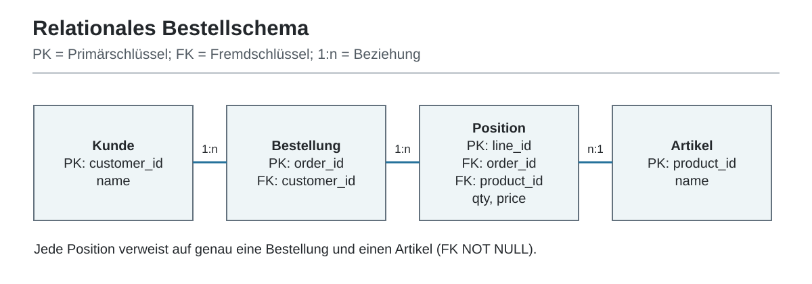

# M7-L1 – Relationale Modellierung und Normalisierung {#L1}

**Kursbereich:** M7 – Datenmanagement

**Niveau:** Bachelor · Kern/Grundlagen

**Vorwissen:** [M6-L2](M6-L2.md)

**Lernziel:** Eine n:m-Beziehung relational abbilden und Schlüssel sowie Normalisierung begründen.

## Einstieg und Grundbegriffe {#S1}

Ein relationales Schema definiert Tabellen, Attribute, Schlüssel und Integritätsbedingungen. Ein Primärschlüssel identifiziert einen Datensatz eindeutig, ein Fremdschlüssel verweist auf einen zulässigen Datensatz in einer anderen oder derselben Tabelle. Funktionale Abhängigkeiten beschreiben, welche Attribute andere bestimmen. Normalisierung reduziert redundante Fakten und damit Änderungsanomalien; sie ersetzt keine bewusste fachliche Modellierung.

## Begriffszusammenhang {#S2}

*Abbildung: Kunde und Bestellung über KundenID verbunden; Position verbindet Bestellung und Artikel, Menge und Preis stehen in Position.*

## Beispiel und Anwendung {#S3}

Ein Kunde kann mehrere Bestellungen aufgeben. Statt Kundenname in jeder Bestellzeile zu speichern, werden Kunde(KundenID, Name) und Bestellung(BestellID, KundenID) getrennt. Die KundenID in Bestellung referenziert Kunde. Eine Pflichtbeziehung benötigt zusätzlich NOT NULL; ein Fremdschlüssel allein erzwingt bei zulässigen NULL-Werten keine Zuordnung. Normalformen werden anhand der funktionalen Abhängigkeiten des konkreten Schemas geprüft. Beispielsweise gilt KundenID → Name; der Name sollte daher nicht als redundantes aktuelles Kundenattribut in Position gespeichert werden. Eine historische Rechnungsanschrift kann dagegen ein eigener, bewusst modellierter Belegbestandteil sein.

## Selbstkontrolle {#S4}

### Aufgabe

Wie modellierst du mehrere Artikel je Bestellung und mehrere Bestellungen je Artikel?

::: {.lc-solutions data-lc-section="S4"}
Eine Zwischentabelle Position mit BestellID und ArtikelID als Fremdschlüsseln und einer eindeutigen Positionskennung; Menge und vereinbarter Preis gehören zur Position.
:::

## Weiterführung {#S5}

[M7-L2](M7-L2.md)

## Quellen und Vertiefung {#S6}

- [PostgreSQL – Documentation 18, Part I. Tutorial](https://www.postgresql.org/docs/18/tutorial.html) · Einführung und Verweis auf SQL-Kapitel; Fachdetailprüfung offen · Zuletzt abgerufen: 2026-11-25
- [PostgreSQL – Constraints](https://www.postgresql.org/docs/current/ddl-constraints.html) · Primär-, Fremd- und CHECK-Schlüsselbedingungen; Fachabschnitt eingesehen · Zuletzt abgerufen: 2026-11-25
