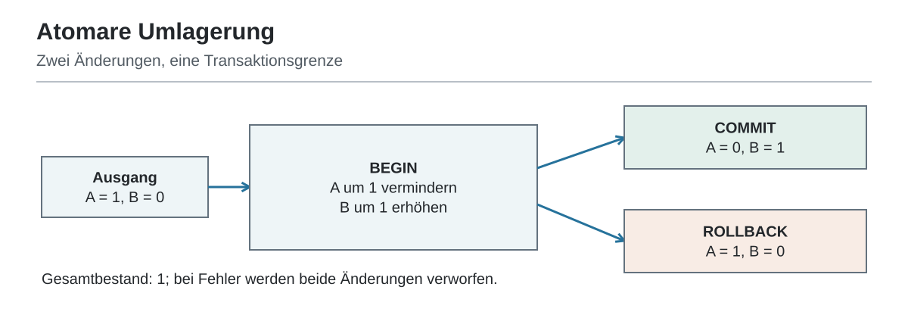

# M7-L2 – SQL und Transaktionsintegrität {#L2}

**Kursbereich:** M7 – Datenmanagement

**Niveau:** Bachelor · Kern/Grundlagen

**Vorwissen:** [M7-L1](M7-L1.md)

**Lernziel:** Eine Bestandsumlagerung transaktional absichern und konkurrierende Reservierungen beurteilen.

## Einstieg und Grundbegriffe {#S1}

SQL beschreibt Abfragen und Änderungen deklarativ. Ein JOIN verbindet Zeilen anhand einer Bedingung; GROUP BY bildet Gruppen für Aggregatfunktionen. Eine Transaktion bündelt mehrere Änderungen in eine logische Einheit. Atomarität verhindert teilweise wirksame Transaktionen, Isolation behandelt Nebenläufigkeit und Dauerhaftigkeit schützt bestätigte Änderungen unter den zugesicherten Systembedingungen.

## Begriffszusammenhang {#S2}

*Abbildung: Ausgangsbestand A 1, B 0; Umlagerung mit COMMIT ergibt A 0, B 1; ROLLBACK erhält A 1, B 0.*

## Beispiel und Anwendung {#S3}

`SELECT customer_id, SUM(amount) FROM orders GROUP BY customer_id;` ermittelt Bestellsummen pro Kunde. Eine Übertragung von Lagerbestand zwischen Standorten muss Abbuchung und Gutschrift in einer Transaktion durchführen; Konkurrenzzugriffe erfordern passende Sperren oder Isolation.

### Vertiefung und Modellgrenzen

Eine Transaktion schützt mehrere Änderungen vor teilweiser Übernahme, aber nicht jede fehlerhafte nebenläufige Geschäftslogik. Isolationsstufen und Sperren beeinflussen beobachtbare Zwischenzustände. Auch bei serialisierbaren Transaktionen können Abbrüche auftreten; eine Wiederholungsstrategie muss die gesamte Transaktion umfassen.

## Selbstkontrolle {#S4}

### Aufgabe

Warum sind zwei unabhängig bestätigte UPDATE-Anweisungen bei einer Umlagerung riskant?

### Modul-Fallstudie

Zwei Kunden möchten jeweils das letzte Exemplar reservieren. Entwirf eine atomare SQL-Änderung für stock(sku,qty). Erkläre, was die Anzahl geänderter Zeilen bedeutet und wie die zugehörige Reservierung in derselben Transaktion entsteht.

::: {.lc-solutions data-lc-section="S4"}
Ein Fehler nach der ersten Änderung kann Bestand verschwinden lassen. Eine gemeinsame Transaktion erlaubt bei Fehlschlag den Rollback beider Änderungen.

**Lösung der Fallstudie:** Unter PostgreSQL: UPDATE stock SET qty=qty-1 WHERE sku='A' AND qty>=1 RETURNING qty; bei genau einer Ergebniszeile Reservierung mit eindeutiger ID einfügen und COMMIT, sonst ROLLBACK. sku muss eindeutig sein. Eine CHECK-Bedingung qty>=0 schützt zusätzlich; qty muss auch NOT NULL sein, da CHECK allein SQL-NULL nicht zurückweist. Die Reservierungs-ID wird vor dem ersten Versuch festgelegt und muss eindeutig sein. Den Transaktionsabbruch beim gewählten Isolationsniveau korrekt behandeln; bei unklarem Commit-Ergebnis die Reservierungs-ID abfragen statt blind erneut abbuchen.

:::

## Weiterführung {#S5}

[M7-L3](M7-L3.md)

## Quellen und Vertiefung {#S6}

- [PostgreSQL – Documentation 18, Part I. Tutorial](https://www.postgresql.org/docs/18/tutorial.html) · Einführung und Verweis auf SQL-Kapitel; Fachdetailprüfung offen · Zuletzt abgerufen: 2026-11-25
- [PostgreSQL Documentation – Transaction Isolation](https://www.postgresql.org/docs/current/transaction-iso.html) · Isolationsstufen, Konflikte und Abbrüche; das Beispiel ist eigenständig · Zuletzt abgerufen: 2026-11-25
- [PostgreSQL – Transactions](https://www.postgresql.org/docs/current/tutorial-transactions.html) · Atomarität und Transaktionsgrenzen; Fachabschnitt eingesehen · Zuletzt abgerufen: 2026-11-25
- [PostgreSQL – Constraints](https://www.postgresql.org/docs/current/ddl-constraints.html) · CHECK und NOT NULL · Zuletzt abgerufen: 2026-11-25
