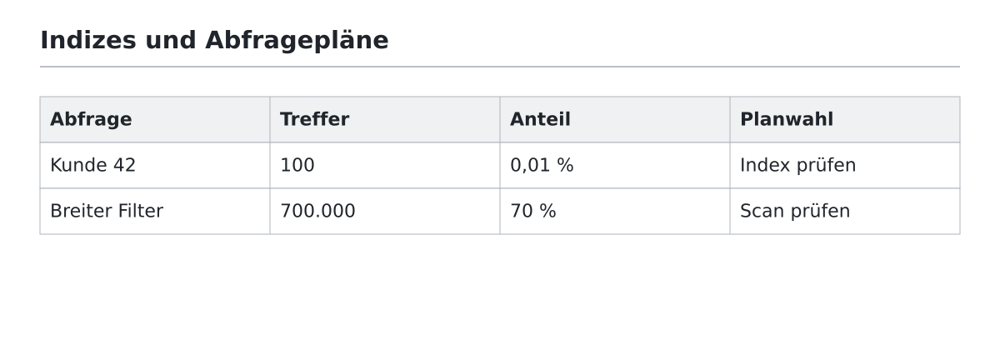

# M7-L3 – Indizes und Abfragepläne {#L3}

**Kursbereich:** M7 – Datenmanagement

**Niveau:** Bachelor · Kern/Grundlagen

**Vorwissen:** [M7-L2](M7-L2.md)

**Lernziel:** Abfrageselektivität berechnen und die Wahl eines Index anhand eines Abfrageplans beurteilen.

## Einstieg und Grundbegriffe {#S1}

Ein Index ist eine zusätzliche Datenstruktur, die Zugriffe auf Teilmengen beschleunigen kann. Ein B-Baum-Index eignet sich für viele Gleichheits- und Bereichsbedingungen; die Datenbank muss den Index bei Schreibvorgängen pflegen. Die Selektivität beschreibt, welcher Anteil der Zeilen eine Bedingung erfüllt. Bei großen Treffermengen kann ein sequenzieller Scan günstiger sein. Der Abfrageoptimierer vergleicht geschätzte Kosten auf Grundlage von Statistiken. In PostgreSQL zeigt EXPLAIN den geplanten Ablauf; EXPLAIN ANALYZE führt die Anweisung tatsächlich aus und ergänzt Messwerte. Bei schreibenden Anweisungen ist deshalb Vorsicht nötig. Die geschätzten Kosten sind keine Millisekunden. Vergleiche geschätzte und tatsächliche Zeilenzahlen, um schlechte Kardinalitätsschätzungen zu erkennen. Ein mehrspaltiger Index sollte zu den häufigen Filtern und Sortierungen passen. Zusätzliche Indizes verursachen Speicher- und Schreibaufwand.

## Begriffszusammenhang {#S2}

*Abbildung: Zwei Filter mit stark unterschiedlicher Selektivität und zu prüfenden Zugriffswegen. Eigenes Modellbeispiel.*

## Beispiel und Anwendung {#S3}

Eine Auftragstabelle enthält 1.000.000 Zeilen; die Abfrage SELECT id, total FROM orders WHERE customer_id = 42 liefert 100 Zeilen. Die beobachtete Selektivität ist 0,01 %. Ein Index auf customer_id könnte die Suche beschleunigen. Führe auf einer Testdatenbank erst EXPLAIN (ANALYZE, BUFFERS) für die SELECT-Abfrage aus, dann CREATE INDEX orders_customer_idx ON orders(customer_id); ANALYZE orders; und wiederhole den Planvergleich. Protokolliere Planart, tatsächliche Zeilen, Pufferzugriffe und Laufzeit mehrfach unter vergleichbaren Lastbedingungen. Es gibt keine garantierte Planart oder Laufzeit; das Experiment dient der Messung.

## Selbstkontrolle {#S4}

### Aufgabe

Eine andere Abfrage findet 700.000 Zeilen. Berechne die Selektivität. Warum darf aus 0,01 % Treffern keine 10.000-fache Beschleunigung abgeleitet werden?

::: {.lc-solutions data-lc-section="S4"}
70 %. Indexnavigation, Zugriff auf Tabellenblöcke, Cache-Zustand, Parallelität und Ausgabe der Treffer kosten ebenfalls Zeit. Die Anzahl gefilterter Zeilen ist kein direktes Maß für Laufzeit. Beide Varianten müssen gemessen werden.
:::

## Weiterführung {#S5}

[M8-L1](M8-L1.md)

## Quellen und Vertiefung {#S6}

- [PostgreSQL – Using EXPLAIN](https://www.postgresql.org/docs/current/using-explain.html) · Methodischer Fachbeleg; relevante Passage im Web eingesehen. Zuletzt abgerufen: 2026-11-25.
