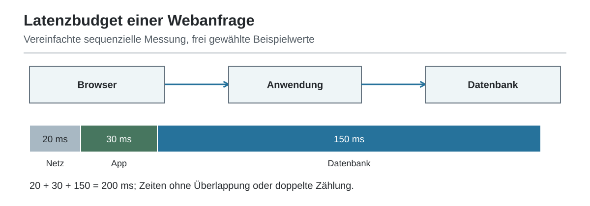

# M8-L1 – Betriebssysteme, Netze und Cloud {#L1}

**Kursbereich:** M8 – IT-Systeme

**Niveau:** Bachelor · Kern/Grundlagen

**Vorwissen:** [M7-L2](M7-L2.md)

**Lernziel:** Latenzanteile einer Webanfrage einordnen und Netz-, Anwendungs- und Datenbankprobleme unterscheiden.

## Einstieg und Grundbegriffe {#S1}

Ein Betriebssystem verwaltet Prozesse, Speicher, Geräte und Dateisysteme. Netzwerke ermöglichen Kommunikation zwischen getrennten Systemen; Protokolle definieren die Regeln dieser Kommunikation. Cloud-Dienste abstrahieren Ressourcen auf unterschiedlichen Ebenen: Infrastruktur, Plattform oder Anwendung. Die Verantwortung für Sicherheit und Betrieb verschiebt sich je nach Service, verschwindet aber nicht.

## Begriffszusammenhang {#S2}

*Abbildung: Browser sendet HTTP-Anfrage an Anwendung; Anwendung fragt Datenbank ab. Beispielzeiten: 20 ms Netz, 30 ms Anwendung, 150 ms Datenbank, insgesamt 200 ms ohne weitere Wartezeiten.*

## Beispiel und Anwendung {#S3}

Eine Firma betreibt einen Webdienst mit Browser, HTTP-Endpunkt, Anwendung und Datenbank. Bei einer Zeitüberschreitung kann die Ursache Netzwerk, Anwendung oder Datenbank sein. Messungen an den Schnittstellen helfen, die Ursache abzugrenzen.

Im vereinfachten Diagramm sind Netzzeit (20 ms), reine Anwendungszeit (30 ms) und Datenbankzeit (150 ms) disjunkt; ihre Summe beträgt 200 ms. In realen Traces dürfen verschachtelte oder parallele Zeitabschnitte nicht einfach addiert werden.

## Selbstkontrolle {#S4}

### Aufgabe

Welche Informationen benötigt ein Betriebsteam, um Datenbank- und Netzprobleme zu unterscheiden?

::: {.lc-solutions data-lc-section="S4"}
Zeitstempel, Verbindungszeiten, Anfrage- und Antwortdauer, Datenbankmetriken und Fehlercodes. Die Zuordnung über eine Korrelations-ID hilft bei verteilten Aufrufen.
:::

## Weiterführung {#S5}

[M8-L2](M8-L2.md)

## Quellen und Vertiefung {#S6}

- [Universität Münster – Aufbau des Wirtschaftsinformatikstudiums (B.Sc.)](https://www.wi.uni-muenster.de/de/studieninteressierte/unsere-studiengaenge/bachelor-science-wirtschaftsinformatik/aufbau-des) · Studienprofil; curricularer Kontext, kein Einzelnachweis der Fachdetails · Zuletzt abgerufen: 2026-11-25
- [NIST SP 800-145 – The NIST Definition of Cloud Computing](https://csrc.nist.gov/pubs/sp/800/145/final) · Cloud-Dienstmodelle; Abstract und Schlagwörter eingesehen, nicht Volltext · Zuletzt abgerufen: 2026-11-25
