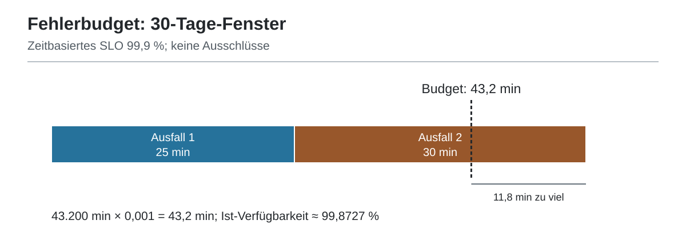

# M8-L2 – Verfügbarkeit, Sicherung und Betrieb {#L2}

**Kursbereich:** M8 – IT-Systeme

**Niveau:** Bachelor · Kern/Grundlagen

**Vorwissen:** [M8-L1](M8-L1.md)

**Lernziel:** Verfügbarkeit und Fehlerbudget berechnen und Sicherungsverfahren anhand von RPO und RTO beurteilen.

## Einstieg und Grundbegriffe {#S1}

Verfügbarkeit ist der Anteil der vereinbarten Beobachtungszeit, in der ein Dienst seine zugesagte Funktion erfüllt. Recovery Time Objective (RTO) bezeichnet die angestrebte Wiederherstellungsdauer; Recovery Point Objective (RPO) den tolerierten Datenverlust gemessen als Zeitspanne. Backups müssen nicht nur vorhanden, sondern auch wiederherstellbar sein. Redundanz kann Ausfälle einzelner Komponenten abfangen, ersetzt aber keine unabhängige Sicherung.

## Begriffszusammenhang {#S2}

*Abbildung: Fehlerbudget 43,2 Minuten; Ausfälle 25 und 30 Minuten; Budget um 11,8 Minuten überschritten.*

## Beispiel und Anwendung {#S3}

Ein Service ist in 30 Tagen von insgesamt 720 Stunden drei Stunden nicht verfügbar. Die Verfügbarkeit beträgt 717/720, also rund 99,583 Prozent. Bei RPO 1 Stunde muss ein Störfallplan einen geeigneten Wiederherstellungspunkt vorsehen.

### Vertiefung und Modellgrenzen

Ein Service-Level-Indikator (SLI) ist eine definierte Messgröße, ein SLO ein Zielwert dafür. Ein SLA ist eine Vereinbarung mit dem Kunden und kann Konsequenzen festlegen. Verfügbarkeit, Fehlerquote und Latenz erfassen unterschiedliche Eigenschaften; Messfenster und Ausschlüsse müssen angegeben sein.

## Selbstkontrolle {#S4}

### Aufgabe

Kann ein tägliches Backup allein ein RPO von einer Stunde garantieren?

### Modul-Fallstudie

Der Dienst hat ein SLO von 99,9 Prozent zeitbasierter Verfügbarkeit in einem 30-Tage-Fenster ohne Ausschlüsse. Zwei Ausfälle dauern 25 und 30 Minuten. Berechne Fehlerbudget, Verbrauch und Restbudget.

::: {.lc-solutions data-lc-section="S4"}
Nein. Ohne zusätzliche geeignete Maßnahmen können seit der letzten Sicherung nahezu 24 Stunden Daten fehlen. Wiederherstellungstests sind zusätzlich erforderlich.

**Lösung der Fallstudie:** 30·24·60=43.200 Minuten, Budget 43,2 Minuten. Verbrauch 55 Minuten, Rest −11,8 Minuten. Verfügbarkeit 1−55/43.200≈99,8727 Prozent; Ziel verfehlt. Bei anfragebasiertem SLI wären die betroffenen Anfragen statt Minuten zu zählen; die beiden Werte dürfen nicht vermischt werden.

:::

## Weiterführung {#S5}

[M8-L3](M8-L3.md)

## Quellen und Vertiefung {#S6}

- [NIST – SP 1303, Cybersecurity Framework 2.0: Enterprise Risk Management Quick-Start Guide](https://csrc.nist.gov/pubs/sp/1303/final) · Abstract: Einbettung von Cybersicherheitsrisiken in Unternehmensrisiken; Leitfaden noch nicht vollständig geprüft · Zuletzt abgerufen: 2026-11-25
- [NIST – Cybersecurity Framework 2.0](https://www.nist.gov/publications/nist-cybersecurity-framework-csf-20) · Rahmenwerk zur Organisation und Bewertung von Cybersicherheitsrisiken; Veröffentlichungsseite, kein Volltextreview · Zuletzt abgerufen: 2026-11-25
- [Google SRE – Service Level Objectives](https://sre.google/sre-book/service-level-objectives/) · SLI, SLO, SLA; Fachabschnitt eingesehen · Zuletzt abgerufen: 2026-11-25
