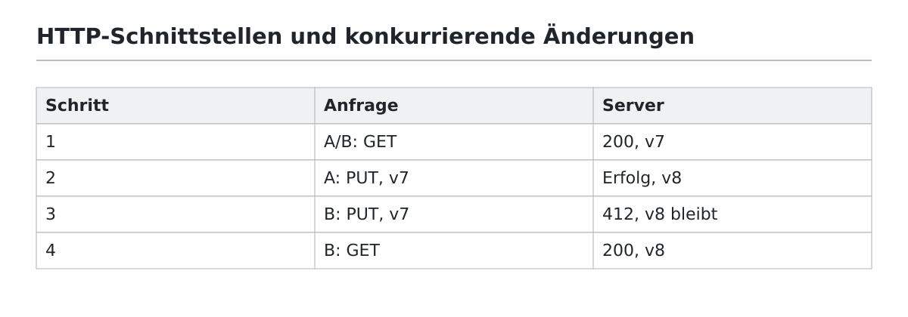

# M8-L3 – HTTP-Schnittstellen und konkurrierende Änderungen {#L3}

**Kursbereich:** M8 – IT-Systeme

**Niveau:** Bachelor · Kern/Grundlagen

**Vorwissen:** [M8-L2](M8-L2.md)

**Lernziel:** Konkurrierende HTTP-Änderungen mithilfe bedingter Anfragen beurteilen.

## Einstieg und Grundbegriffe {#S1}

HTTP überträgt Anfragen und Antworten zwischen Client und Server. Die Methode beschreibt die beabsichtigte Semantik, ein Statuscode das Ergebnis; Header ergänzen Metadaten. GET dient dem Abruf und soll keine fachliche Zustandsänderung verlangen. PUT setzt die Repräsentation einer Ressource; die beabsichtigte Wirkung wiederholter identischer PUT-Anfragen ist idempotent. POST besitzt diese Garantie nicht grundsätzlich. Die HTTP-Eigenschaft safe (semantisch lesend) ist keine IT-Sicherheitsgarantie. Safe und idempotent beschreiben die beabsichtigte Methodensemantik; Protokollierung und andere nicht angeforderte Nebeneffekte sind dadurch nicht ausgeschlossen.

Konkurrierende Bearbeitung kann zum Verlust einer Änderung führen, wenn zwei Clients dieselbe Ausgangsversion lesen und anschließend unabhängig speichern. Ein starker ETag kennzeichnet die Version einer Repräsentation. Mit If-Match kann ein Client die Änderung von der zuvor gelesenen Version abhängig machen. Die Prüfung und die eigentliche Aktualisierung müssen serverseitig atomar umgesetzt werden; eine bloße Vorabprüfung in der Oberfläche reicht nicht. Bei einer nicht erfüllten Vorbedingung darf die angeforderte Methode nicht ausgeführt werden; HTTP 412 ist der typische Fehlerstatus. RFC 9110 erlaubt unter bestimmten Voraussetzungen eine erfolgreiche Antwort, wenn die Änderung erkennbar bereits erfolgt ist. Danach sind die aktuelle Fassung abzurufen und Konflikte fachlich zu lösen. Zugriffskontrolle, TLS und fachliche Validierung werden dadurch nicht ersetzt.

## Begriffszusammenhang {#S2}

*Abbildung: Zeitliche Abfolge einer bedingten HTTP-Aktualisierung. Eigenes Modellbeispiel.*

## Beispiel und Anwendung {#S3}

Zwei Einkaufsmitarbeiter lesen einen Lieferantenstammsatz mit `ETag: "v7"`. A ändert die Zahlungsfrist und sendet PUT mit `If-Match: "v7"`. Der Server akzeptiert, speichert und kennzeichnet die neue Version mit `"v8"`. B sendet seine unabhängige Änderung mit `If-Match: "v7"`. Im angenommenen strikten Serververtrag erhält B 412 und es wird nichts überschrieben. B lädt v8, prüft die geänderten Werte und sendet nach fachlicher Konfliktlösung eine neue Anfrage mit v8. Das Beispiel beschreibt ein Protokoll, keine vollständige REST-Architektur.

## Selbstkontrolle {#S4}

### Aufgabe

Warum hilft ein GET unmittelbar vor PUT allein nicht zuverlässig? Nenne die erwartete Antwort für eine erneut gesendete Anfrage mit veraltetem v7 nach erfolgreicher Änderung unter dem strikten Vertrag.

::: {.lc-solutions data-lc-section="S4"}
Ein anderer Client kann zwischen GET und PUT schreiben. Die atomare Versionsprüfung verhindert dies. Im strikten Modell: 412; eine automatische Wiederholung ohne Konfliktprüfung ist nicht sinnvoll.
:::

## Weiterführung {#S5}

[M8-L4](M8-L4.md)

## Quellen und Vertiefung {#S6}

- [IETF – RFC 9110, HTTP Semantics, §§ 9, 13.1.1](https://www.rfc-editor.org/rfc/rfc9110.html) · Methodischer Fachbeleg; relevante Passage im Web eingesehen. Zuletzt abgerufen: 2026-11-25.
