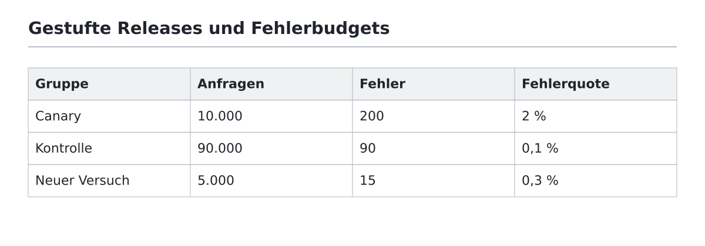

# M8-L4 – Gestufte Releases und Fehlerbudgets {#L4}

**Kursbereich:** M8 – IT-Systeme

**Niveau:** Bachelor · Kern/Grundlagen

**Vorwissen:** [M8-L3](M8-L3.md)

**Lernziel:** Fehlerraten eines Canary-Releases berechnen und eine Freigabeentscheidung begründen.

## Einstieg und Grundbegriffe {#S1}

Ein Canary-Release setzt eine neue Softwareversion zunächst nur für einen begrenzten Teil der Produktionslast ein. Der Vergleich mit einer Kontrollgruppe soll problematische Änderungen erkennen, bevor die gesamte Last umgestellt wird. Die Kriterien umfassen nicht nur technische Fehlerraten, sondern auch Antwortzeit, fachlich erfolgreiche Vorgänge und Konsistenz. Ein unrepräsentativer Testteil oder gemeinsam genutzte defekte Abhängigkeiten können das Ergebnis verfälschen.

Ein Service Level Objective (SLO) definiert ein messbares Zuverlässigkeitsziel. Bei einem anfragenbasierten Ziel von 99,9 % erfolgreichen Anfragen beträgt der zulässige Fehleranteil 0,1 %. Das Fehlerbudget für einen Zeitraum ist dieser Anteil multipliziert mit der beobachteten Zahl relevanter Anfragen. Die Zuordnung von Fehlern und die Definition einer relevanten Anfrage müssen vorab festliegen. Ein Canary ist keine Garantie: fehlerhafte Datenänderungen können auch bei kleiner Last irreversibel sein; Rückfall und Wiederherstellung müssen eigenständig geplant werden.

## Begriffszusammenhang {#S2}

*Abbildung: Fehlerraten in einem gestuften Release. Eigenes Modellbeispiel.*

## Beispiel und Anwendung {#S3}

Ein Shop erwartet 1.000.000 relevante Anfragen im Monat. Bei 99,9 % Zielwert stehen unter dieser Annahme 1.000 Fehler zur Verfügung. Bisher traten 350 Fehler auf. Ein Canary verarbeitet 10.000 Anfragen, davon 200 fehlerhaft; die Kontrollgruppe verarbeitet 90.000 Anfragen mit 90 Fehlern. Die Raten betragen 2 % gegenüber 0,1 %. Zusammen entstehen 290 weitere Fehler, sodass 360 des angenommenen Monatsbudgets verbleiben. Das Team stoppt die Ausweitung nach seiner vorab festgelegten Schwelle von maximal 0,5 % Canary-Fehlern. Die beobachtete Rate ist nicht mit einer kausal bewiesenen Fehlerursache gleichzusetzen.

Bei vollständiger Ausrollung und unveränderter Rate von 2 % wären für 100.000 Anfragen 2.000 Fehler zu erwarten; dies ist eine kontrafaktische Modellrechnung, keine Messung. Die tatsächliche Budgetabrechnung erfolgt anhand der real beobachteten Monatslast.

## Selbstkontrolle {#S4}

### Aufgabe

Ein neuer Versuch hat 5.000 Canary-Anfragen und 15 Fehler. Berechne die Rate. Ist damit allein die Ausweitung ausreichend begründet?

::: {.lc-solutions data-lc-section="S4"}
15/5.000 = 0,3 %, unter 0,5 %. Nein: Kontrollvergleich, Repräsentativität, verbleibendes Fehlerbudget, fachliche Kennzahlen und Rückfallfähigkeit sind zusätzlich zu prüfen.
:::

## Weiterführung {#S5}

[M9-L1](M9-L1.md)

## Quellen und Vertiefung {#S6}

- [Google SRE Workbook – Canarying Releases](https://sre.google/workbook/canarying-releases/) · Methodischer Fachbeleg; relevante Passage im Web eingesehen. Zuletzt abgerufen: 2026-11-25.
