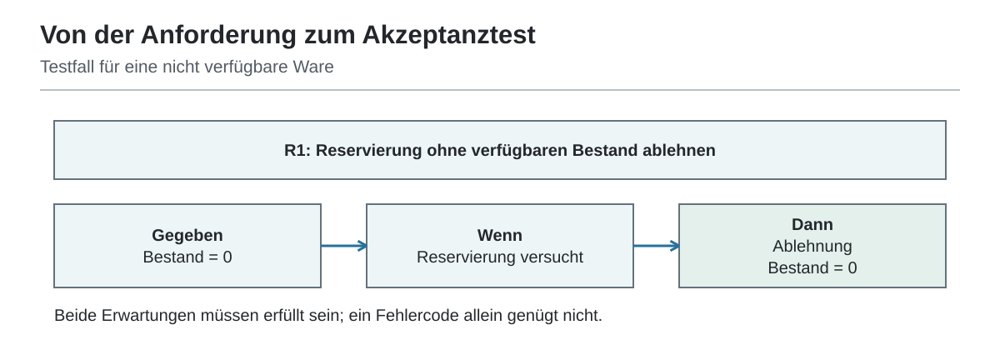

# M9-L1 – Anforderungen und Modellierung {#L1}

**Kursbereich:** M9 – Software Engineering

**Niveau:** Bachelor · Kern/Grundlagen

**Vorwissen:** [M8-L2](M8-L2.md)

**Lernziel:** Messbare Qualitätsanforderungen für einen Reservierungsdienst und zugehörige Akzeptanzkriterien formulieren.

## Einstieg und Grundbegriffe {#S1}

Funktionale Anforderungen beschreiben, was ein System leisten soll; Qualitätsanforderungen definieren messbare Eigenschaften wie Antwortzeit oder Verfügbarkeit. Akzeptanzkriterien übersetzen Anforderungen in überprüfbare Bedingungen. Modelle wie UML-Diagramme können Struktur oder Verhalten darstellen, sind aber keine vollständige Implementierung. Eine Rückverfolgbarkeit von Anforderungen zu Tests reduziert unbeabsichtigte Lücken.

## Begriffszusammenhang {#S2}

*Abbildung: Akzeptanztest für Bestand null: Reservierung abgelehnt, Bestand bleibt null.*

## Beispiel und Anwendung {#S3}

Eine Anforderung lautet: Reservierungen müssen nicht verfügbare Artikel zurückweisen. Ein Akzeptanztest setzt Bestand null, versucht eine Reservierung und erwartet eine fachliche Ablehnung sowie unveränderten Bestand.

## Selbstkontrolle {#S4}

### Aufgabe

Formuliere eine messbare Qualitätsanforderung für den Reservierungsdienst.

::: {.lc-solutions data-lc-section="S4"}
Beispiel: Bei definierter Last von 50 Anfragen pro Sekunde sollen mindestens 95 Prozent der gültigen Reservierungsanfragen innerhalb von 300 ms beantwortet werden. Messumgebung, Messfenster und Fehlerbehandlung sind zu definieren. Schnelle Fehlerantworten dürfen nicht als Beleg für erfolgreiche Reservierungen gewertet werden; die Erfolgsquote ist separat zu spezifizieren.
:::

## Weiterführung {#S5}

[M9-L2](M9-L2.md)

## Quellen und Vertiefung {#S6}

- [Object Management Group – About UML 2.5.1](https://www.omg.org/spec/UML) · Offizieller Spezifikationseinstieg; Normtext nicht vollständig geprüft · Zuletzt abgerufen: 2026-11-25
