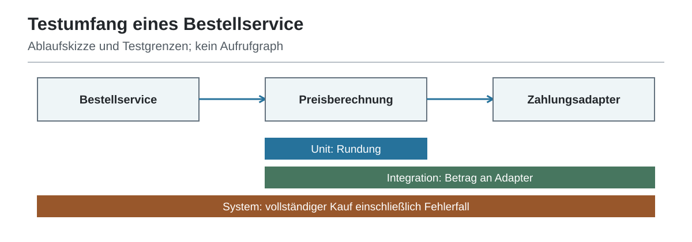

# M9-L2 – Softwarearchitektur und Teststrategie {#L2}

**Kursbereich:** M9 – Software Engineering

**Niveau:** Bachelor · Kern/Grundlagen

**Vorwissen:** [M9-L1](M9-L1.md)

**Lernziel:** Testebenen unterscheiden und Akzeptanztests für wiederholte Zahlungs- und Reservierungsanfragen entwerfen.

## Einstieg und Grundbegriffe {#S1}

Architektur legt Komponenten, Zuständigkeiten, Abhängigkeiten und wichtige Schnittstellen fest. Eine modulare Struktur erleichtert Änderungen, wenn Schnittstellen stabil sind. Unit-Tests prüfen kleine Einheiten, Integrationstests ihr Zusammenwirken und Systemtests komplette Abläufe. Automatisierte Tests bilden nur die spezifizierten Fälle ab; Code-Reviews, Lasttests und Gebrauchstauglichkeit ergänzen sie.

## Begriffszusammenhang {#S2}

*Abbildung: Drei Prüfbereiche: Rundung in der Preisfunktion, korrekter Betrag am Zahlungsadapter, gesamter Kauf mit Fehlerfall.*

## Beispiel und Anwendung {#S3}

Ein Bestellservice ruft eine Preisberechnung und einen Zahlungsadapter auf. Ein Unit-Test prüft Rundungsregeln, ein Integrationstest die Übergabe des korrekten Betrags und ein Systemtest den gesamten Kauf einschließlich Fehlerfall.

### Vertiefung und Modellgrenzen

Eine Schnittstelle ist ein Vertrag über Eingaben, Ergebnisse, Fehler und Nebenwirkungen. Idempotenz bedeutet, dass die beabsichtigte Wirkung wiederholter gleicher Operationen der einmaligen Wirkung entspricht. Tests müssen den Vertrag, nicht nur die interne Implementierung, prüfen.

## Selbstkontrolle {#S4}

### Aufgabe

Wie prüfst du, dass ein erneuter Zahlungsaufruf nach einem Timeout keine doppelte Belastung erzeugt?

### Modul-Fallstudie

Entwirf drei Akzeptanztests für POST /reservations mit einer Idempotenz-ID. Berücksichtige einen wiederholten Request, dieselbe ID mit geänderten Eingaben und einen Timeout nach dem Commit.

::: {.lc-solutions data-lc-section="S4"}
Simuliere einen Timeout nach wirksamer Zahlung, wiederhole die Anfrage mit gleicher eindeutiger Transaktionskennung und prüfe, dass nur eine Belastung vorliegt. Die Gegenstelle muss dieses Verhalten unterstützen.

**Lösung der Fallstudie:** Erste Wiederholung: genau eine Bestandsänderung und dieselbe Reservierungs-ID. Geänderte Nutzlast bei gleicher ID: Konflikt, keine weitere Änderung. Timeout nach Commit: Wiederholung liefert das bereits gespeicherte Ergebnis ohne zweite Änderung. Der Server muss ID, Eingabeprüfung und Geschäftsvorgang konsistent speichern; Gültigkeitsdauer und Mandantengrenze dokumentieren.

:::

## Weiterführung {#S5}

[M9-L3](M9-L3.md)

## Quellen und Vertiefung {#S6}

- [Universität Münster – Aufbau des Wirtschaftsinformatikstudiums (B.Sc.)](https://www.wi.uni-muenster.de/de/studieninteressierte/unsere-studiengaenge/bachelor-science-wirtschaftsinformatik/aufbau-des) · Studienprofil; curricularer Kontext, kein Einzelnachweis der Fachdetails · Zuletzt abgerufen: 2026-11-25
- [IETF – RFC 9110, HTTP Semantics, §§ 9, 13.1.1](https://www.rfc-editor.org/rfc/rfc9110.html) · HTTP-Methodensemantik; anwendungsspezifische Idempotenz-ID ist eigener Entwurf · Zuletzt abgerufen: 2026-11-25
