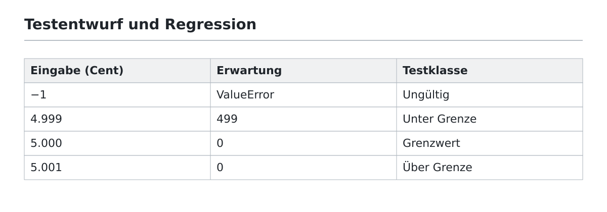

# M9-L3 – Testentwurf und Regression {#L3}

**Kursbereich:** M9 – Software Engineering

**Niveau:** Bachelor · Kern/Grundlagen

**Vorwissen:** [M9-L2](M9-L2.md)

**Lernziel:** Grenzwerttests für eine Versandkostenregel implementieren und Regressionen erkennen.

## Einstieg und Grundbegriffe {#S1}

Tests vergleichen beobachtetes Verhalten mit einer begründeten Erwartung (Testorakel). Unit-Tests prüfen kleine Einheiten, Integrationstests die Zusammenarbeit realer Komponenten und Systemtests vollständige Abläufe. Äquivalenzklassen gruppieren Eingaben mit ähnlichem erwartetem Verhalten; Grenzwertanalyse untersucht Übergänge. Eine Fehlerkorrektur sollte durch einen Regressionstest abgesichert werden, der vor der Korrektur fehlschlägt und danach erfolgreich ist. Hohe Codeabdeckung allein garantiert keine sinnvollen Prüfungen. Tests müssen auch fachliche Invarianten prüfen, etwa nichtnegative Mengen und konsistente Rundung. Nutze für Geldwerte ganzzahlige Centbeträge oder eine passende Dezimalarithmetik mit expliziter Rundungsregel. Automatisierte Tests sollten reproduzierbar sein und ihre Daten nicht unkontrolliert aus produktiven Systemen beziehen.

## Begriffszusammenhang {#S2}

*Abbildung: Grenzwerttests für eine Versandkostenregel. Eigenes Modellbeispiel.*

## Beispiel und Anwendung {#S3}

Ein Shop berechnet Versandkosten von 499 Cent unter einem Warenwert von 5.000 Cent; darüber und bei genau 5.000 Cent ist der Versand kostenlos. Negative Werte sind unzulässig. Der Vertrag lässt sich mit Python unittest testen: Fälle −1 (ValueError), 0 (499), 4.999 (499), 5.000 (0) und 5.001 (0). Eine fehlerhafte Implementierung mit `if cents > 5000` statt `>=` würde genau am Übergang auffallen. Ein Integrationstest prüft zusätzlich, ob der Warenkorb tatsächlich den Centbetrag ohne Versandkosten an diese Funktion übergibt.

## Selbstkontrolle {#S4}

### Aufgabe

Implementiere `shipping(cents)` mit der beschriebenen Regel und einen unittest-Test für 5.000. Welche zusätzliche Prüfung wäre für eine Rückerstattung erforderlich?

::: {.lc-solutions data-lc-section="S4"}
Implementierung: `if cents < 0: raise ValueError()`; danach `return 0 if cents >= 5000 else 499`. In einer Methode einer `unittest.TestCase`-Unterklasse: `self.assertEqual(shipping(5000), 0)`. Rückerstattung erfordert eine explizite Geschäftsregel, ob Versandkosten rückwirkend neu berechnet oder unverändert bleiben; ohne diese Regel gibt es kein eindeutiges Testorakel.
:::

## Weiterführung {#S5}

[M10-L1](M10-L1.md)

## Quellen und Vertiefung {#S6}

- [Python documentation – unittest](https://docs.python.org/3/library/unittest.html) · Methodischer Fachbeleg; relevante Passage im Web eingesehen. Zuletzt abgerufen: 2026-11-25.
